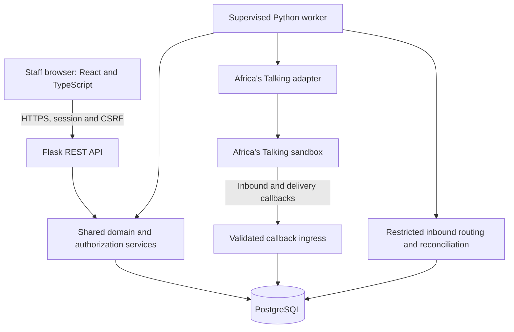

# Technical architecture

> **DRAFT — Proposed refinement. Synthetic patient data exclusively.**

## Architecture decision

Use a modular Flask application, React/TypeScript frontend, PostgreSQL, and a separate supervised Python messaging worker. Integrate Africa's Talking sandbox through an adapter. This keeps transactional rules centralized and infrastructure modest.

## Module ownership

| Module | Owns |
| --- | --- |
| Identity | Accounts, sessions, MFA, recovery, roles, role bindings |
| Facilities | Facilities, memberships, teams, messaging policy |
| Assignments | Caseloads, episode-facility responsibility, transfer workflow |
| Patients | Opaque identity, local profiles, contacts, eligibility |
| Pregnancies | Episodes, dating revisions, communication lifecycle, completion |
| Consent | Notice versions, append-only evidence/events, effective-purpose checks |
| Appointments | Versioned guidance, booking/revision history, attendance |
| Content | Template versions, review decisions, publication/suspension |
| Messaging | Occurrences, dispatch/attempt state, callbacks, reservations |
| Inbound | Callback persistence, classification, ambiguity, safe association |
| Follow-up | Restricted cases, assignment, acknowledgement, disposition |
| Reporting | Scope-aware operational and aggregate views |
| Audit | Sensitive access and significant change events |

API handlers validate and invoke services; they do not implement clinical rules. The worker calls the same eligibility/content services. Modules expose service interfaces rather than performing unrelated modules' raw table updates.

## Runtime units

1. Static React frontend, preferably same-origin with the API.
2. Flask API behind TLS/reverse proxy.
3. Independently supervised worker with heartbeat and restart policy.
4. Managed PostgreSQL with encrypted backup and restoration support.

No scheduler runs independently in each Flask process. Worker parallelism uses PostgreSQL row locks and leases. A paused/sleeping host is unsuitable for reliable worker operation. Hosting provider and sizing remain D12/D14.

## Transaction boundaries

- Clinical mutations, their history, invalidation of affected work, and audit are one database transaction.
- Transfer acceptance locks the current assignment and closes/opens responsibility atomically.
- Consent withdrawal updates effective restrictions and invalidates pending work atomically.
- Creating an occurrence and its durable dispatch is idempotent under unique constraints.
- Reserving budget and authorizing a send are atomic database steps.
- Provider network calls occur outside long-lived database transactions. Submission intent is committed first; unknown results are reconciled, not blindly retried.
- Durable provider events are acknowledged only after persistence. Processing can occur asynchronously.

The provider cannot participate in a PostgreSQL transaction. The design therefore makes the uncertainty boundary explicit rather than promising exactly-once delivery or recall after submission.

## Tenant and patient boundaries

Canonical patients and episodes retain stable identifiers across facilities. Identifiable local profiles and clinical records carry explicit facility ownership. Episode-facility assignments authorize current clinical work; participant/team assignments narrow user access.

Accepted transfers expose a deliberately limited handover. They do not change ownership of historical appointments or open the destination's later records to source staff. See [security](security-and-consent.md).

## Frontend design

- Route-level role checks improve usability; backend enforcement remains authoritative.
- Responsive forms, accessible labels, paginated caseloads, and explicit save/conflict states.
- Separate VHT, clinical, administrator, content-review, platform-operations, and analyst workspaces.
- No PHI in URLs, analytics, client logs, localStorage, or offline caches.
- Requests use same-origin session cookies and CSRF tokens for mutations.
- Display synthetic-data and sandbox status clearly in demonstrations.

## Operations and scaling

Observe worker heartbeat, oldest due work, callback lag, unknown submissions, delivery failures, follow-up backlog, budget availability, and authentication failures. Technical telemetry must exclude patient content and credentials.

Scale indexed queries and bounded worker batches before adding infrastructure. A new queue or provider must preserve occurrence identities, authorization, reconciliation, and the audit contract.

## Future postnatal extension

Keep patient identity independent of pregnancy, purpose-scoped consent, programme-aware templates/occurrences, and an auditable pregnancy-completed event. Do not create newborn records, postnatal enrolment, or postnatal schedules now. Existing pregnancy consent cannot silently authorize a later programme.

## Review of earlier baseline

This refinement adds physical schema contracts, explicit permission identifiers, authentication records, endpoint contracts, fail-closed policies, and recovery states. The earlier estimate remains provisional. Unconfirmed clinical policy is tracked in the [decision register](unresolved-decisions.md), not converted into hard-coded defaults.
