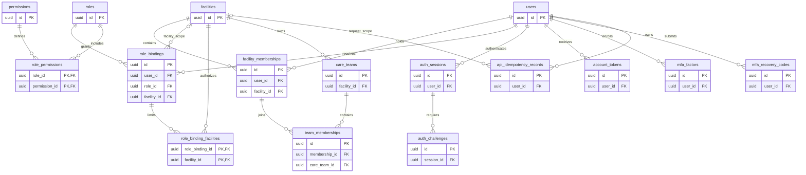
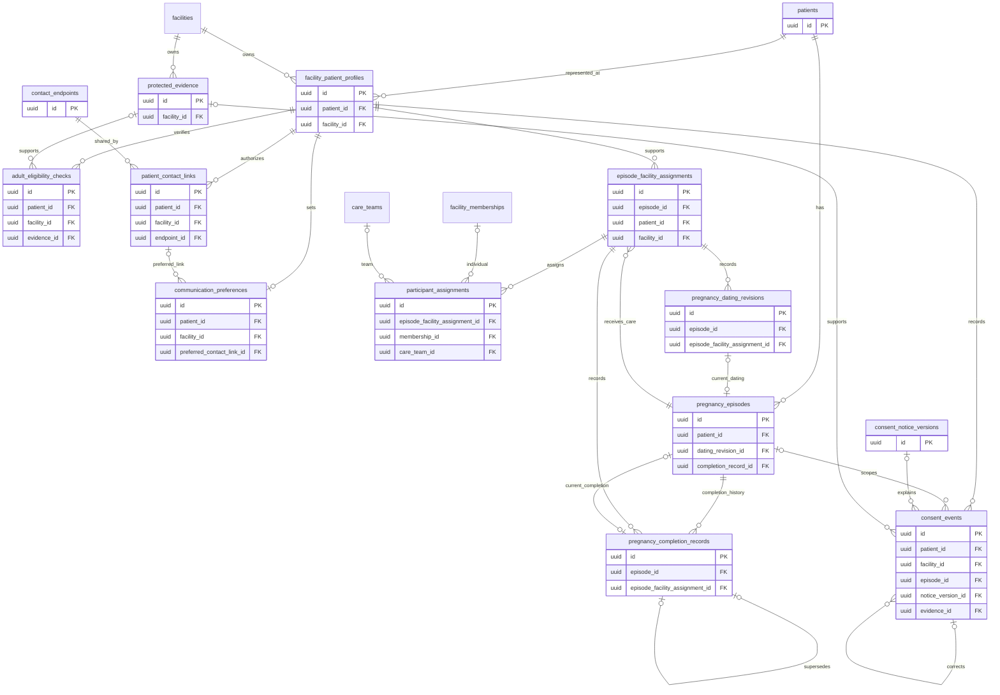
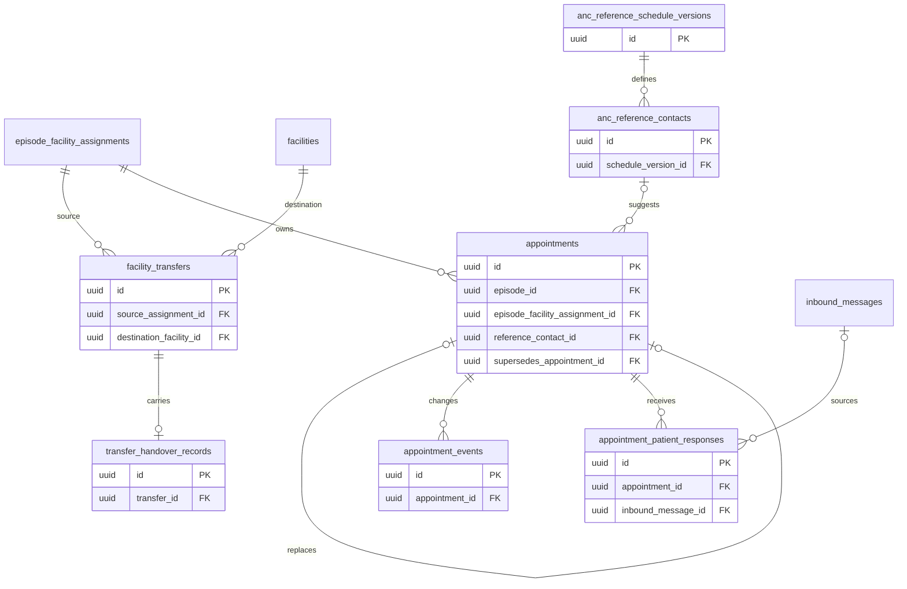
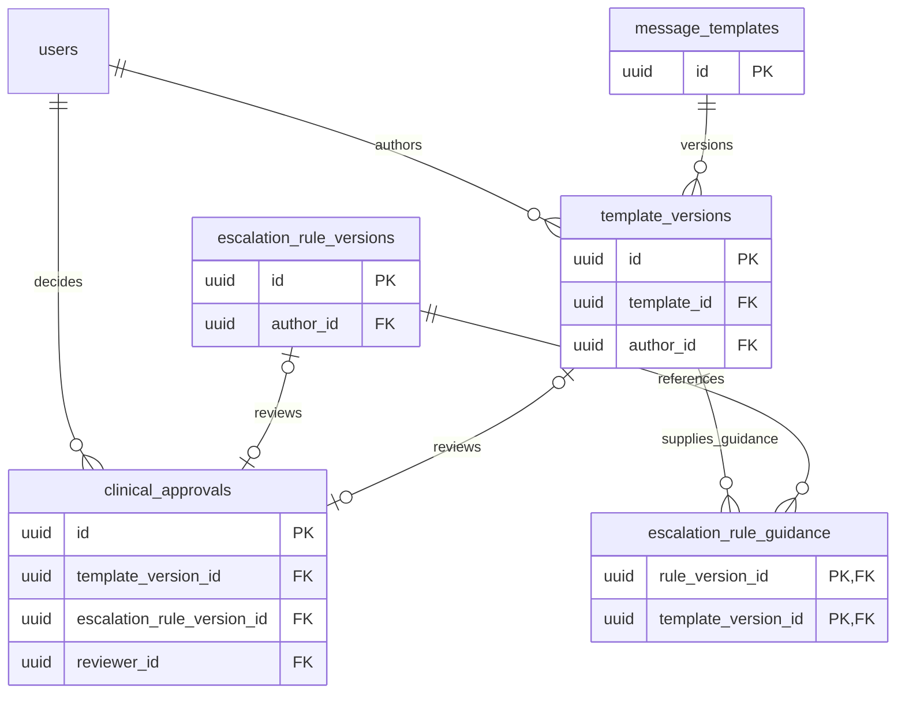
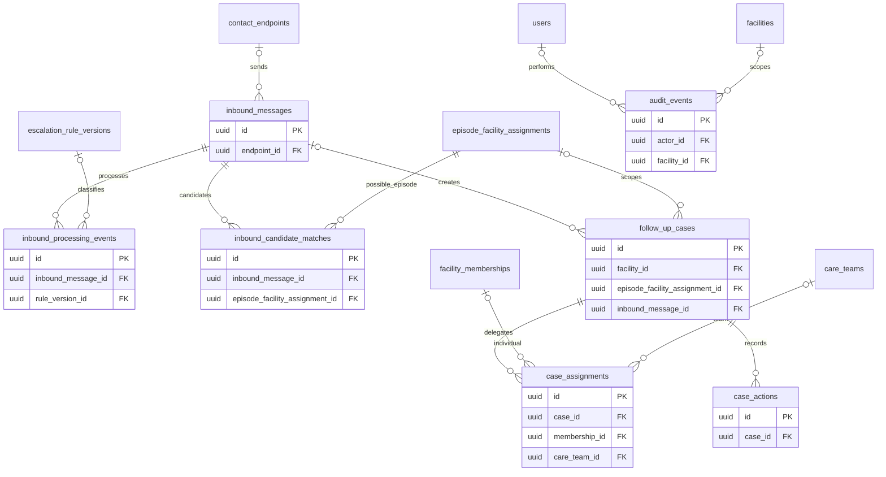

# PostgreSQL schema and entity relationship model

> **DRAFT — Proposed physical design, not executable migrations. Synthetic patient data exclusively. Policy values remain in the decision register.**

## 1. Dictionary conventions

- Every entity has `id uuid PK` and `created_at timestamptz NOT NULL` unless a composite primary key is explicitly shown.
- `!` means NOT NULL; `?` means nullable. Foreign keys use UUID unless stated otherwise.
- Mutable aggregates include `updated_at timestamptz!` and `version integer! CHECK > 0`; history/event tables are append-only.
- All instants use `timestamptz`; clinical dates use `date`. Currency uses `numeric(14,4)`, never floating point.
- `cipher bytea` means authenticated encrypted data. Every row containing ciphertext also has `key_version text!` (implicit in the dictionary when not repeated). A secret/ciphertext is not a plain JSON string.
- Every FK defaults to `ON DELETE RESTRICT`. The exceptions are role-permission and binding-facility join rows, which may cascade only when an otherwise unused parent is deliberately removed. No patient/clinical/audit cascade deletion.
- Status/purpose/code fields are bounded text plus explicit CHECK/allowlist. Clinical policy values requiring agreement are not fabricated.
- Clinical ownership shorthand **C**: `facility_id!`, `episode_id!`, `episode_facility_assignment_id!`; composite FK `(episode_facility_assignment_id, episode_id, facility_id)` references the matching unique key on `episode_facility_assignments`.
- Local profile shorthand **P**: `(patient_id!, facility_id!)` references unique `(patient_id, facility_id)` on `facility_patient_profiles`.
- Actor fields reference `users`; service actions additionally record a bounded `service_actor` label. At least one actor identity is required in audited operations.
- Names such as `episode_id` reference `pregnancy_episodes.id`; `endpoint_id` references `contact_endpoints.id`; `membership_id` references `facility_memberships.id`. The diagrams and explicit references below disambiguate other FKs.

## 2. ERD

The following diagrams partition **one schema** for readability. Repeated entity names are the same tables. Attribute blocks show keys; the dictionary supplies all remaining columns and constraints. No clinical child table may bypass ownership by referencing only a bare episode UUID.

### Identity, authorization, authentication

### Participant, episode, consent, and responsibility

### Transfers and appointments

### Clinical content and escalation rules

### Messaging and cost control

```mermaid
erDiagram
    pregnancy_episodes ||--o{ message_occurrences : triggers
    appointments o|--o{ message_occurrences : reminds
    inbound_messages o|--o{ message_occurrences : approved_response
    message_occurrences ||--o| message_dispatches : executes
    template_versions ||--o{ message_dispatches : renders
    patient_contact_links ||--o{ message_dispatches : addresses
    message_dispatches ||--o{ dispatch_attempts : attempts
    dispatch_attempts o|--o{ sms_delivery_events : reports
    contact_endpoints ||--o{ contact_suppressions : blocks
    inbound_messages o|--o{ contact_suppressions : triggers
    facilities o|--o{ messaging_policies : configures
    facilities o|--o{ messaging_budgets : limits
    messaging_budgets ||--o{ cost_reservations : reserves
    dispatch_attempts ||--o{ cost_reservations : incurs
    dispatch_attempts o|--o{ provider_cost_entries : reconciles
    message_occurrences {
        uuid id PK
        uuid episode_id FK
        uuid appointment_id FK
    }
    message_dispatches {
        uuid id PK
        uuid occurrence_id FK
        uuid template_version_id FK
        uuid contact_link_id FK
        uuid episode_facility_assignment_id FK
    }
    dispatch_attempts {
        uuid id PK
        uuid dispatch_id FK
    }
    sms_delivery_events {
        uuid id PK
        uuid attempt_id FK
    }
    contact_suppressions {
        uuid id PK
        uuid endpoint_id FK
    }
    messaging_policies {
        uuid id PK
        uuid facility_id FK
    }
    messaging_budgets {
        uuid id PK
        uuid facility_id FK
    }
    cost_reservations {
        uuid id PK
        uuid budget_id FK
        uuid attempt_id FK
    }
    provider_cost_entries {
        uuid id PK
        uuid attempt_id FK
    }
```

### Inbound, follow-up, and audit

## 3. Identity and authentication dictionary

| Entity | Additional columns / references | Keys and checks |
| --- | --- | --- |
| `facilities` | `code text!`, `name text!`, `timezone text!`, `active boolean!` | Unique code; valid IANA timezone validated by service; mutable |
| `users` | `login_identifier text!`, `display_name text!`, `password_hash text!`, `status text!`, `security_version integer!` | Case-normalized login unique; invited/active/disabled; no self-registration |
| `roles` | `code text!`, `name text!`, `scope_kind text!` | Unique code; facility/platform/programme scope; locked seed definitions reviewed |
| `permissions` | `code text!`, `description text!` | Unique permission code from permission document |
| `role_permissions` | `role_id!`, `permission_id!` | Composite PK `(role_id,permission_id)` |
| `facility_memberships` | `user_id!`, `facility_id!`, `status text!`, `starts_at timestamptz!`, `ends_at timestamptz?` | Unique `(user_id,facility_id)`; unique `(id,facility_id)` for composite FKs; valid interval |
| `role_bindings` | `user_id!`, `role_id!`, `facility_id?`, `scope_kind text!`, `starts_at!`, `ends_at?`, `granted_by! -> users` | Facility scope requires matching active membership; others require null facility; role scope matches; service/constraint trigger verifies delegation |
| `role_binding_facilities` | `role_binding_id!`, `facility_id!` | Composite PK; only programme bindings; nonempty approved facility list before activation |
| `care_teams` | `facility_id!`, `code text!`, `name text!`, `active boolean!` | Unique `(facility_id,code)` and `(id,facility_id)` |
| `team_memberships` | `facility_id!`, `membership_id!`, `care_team_id!`, `starts_at!`, `ends_at?` | Composite FKs align membership/team facility; no overlapping duplicate active membership |
| `auth_sessions` | `user_id!`, `token_hash bytea!`, `state text!`, `expires_at!`, `last_seen_at!`, `revoked_at?`, `security_version integer!` | Token hash unique; pending_mfa/active/revoked; no plaintext token |
| `auth_challenges` | `session_id! -> auth_sessions`, `kind text!`, `expires_at!`, `attempt_count integer!`, `consumed_at?` | Attempt count >= 0; expiring, bounded, single-use successful completion |
| `account_tokens` | `user_id!`, `purpose text!`, `token_hash bytea!`, `expires_at!`, `consumed_at?` | Invitation/password_reset; hash unique; one-time atomic consume |
| `mfa_factors` | `user_id!`, `kind text!`, `secret_cipher bytea!`, `key_version text!`, `verified_at?`, `revoked_at?`, `last_verified_step bigint?` | No factor use before verification; encrypted secret; atomic TOTP counter advancement prevents reuse across challenges |
| `mfa_recovery_codes` | `user_id!`, `code_hash bytea!`, `consumed_at?` | Hash unique; atomic single-use consume |
| `api_idempotency_records` | `user_id!`, `facility_id?`, `operation text!`, `key text!`, `request_hash bytea!`, `response_cipher bytea?`, `response_status smallint?`, `state text!`, `expires_at!` | Unique `(user_id,operation,key)`; stored facility included in hash/scope; pending/complete; complete requires stored status; no plaintext PHI response cache |

## 4. Participant, consent, and care dictionary

| Entity | Additional columns / references | Keys and checks |
| --- | --- | --- |
| `patients` | Opaque stable identity only; no globally exposed demographics | UUID continuity across episodes; no global staff search |
| `facility_patient_profiles` | `patient_id!`, `facility_id!`, `local_reference text!`, `demographics_cipher bytea!`, `key_version text!`, `status text!` | Unique `(patient_id,facility_id)` and `(facility_id,local_reference)`; registration field allowlist D02 |
| `protected_evidence` | `facility_id!`, `storage_reference text!`, `digest bytea!`, `media_type text!`, `recorded_by! -> users` | Private reference, not public URL; unique `(id,facility_id)`; restricted access |
| `adult_eligibility_checks` | P; `method text!`, `result text!`, `checked_at!`, `checked_by! -> users`, `evidence_id?` | Verified/uncertain/ineligible; composite evidence/facility FK; evidence sufficiency D02 |
| `contact_endpoints` | `number_cipher bytea!`, `lookup_hmac bytea!`, `key_version text!`, `status text!` | Unique normalized endpoint HMAC, **not** unique patient phone; unlimited authorized patient links; restricted global table |
| `patient_contact_links` | P; `endpoint_id!`, `shared boolean!`, `verified_at?`, `valid_from!`, `valid_to?` | Unique `(id,patient_id,facility_id)`; valid interval; prevent duplicate overlapping identical links |
| `communication_preferences` | P; `preferred_contact_link_id? -> patient_contact_links`, `language text!`, `window_start time?`, `window_end time?`, `privacy_flags jsonb!` | Unique `(patient_id,facility_id)`; composite contact/patient/facility FK; en/lg; allowlisted privacy flags; windows validated D08 |
| `pregnancy_episodes` | `patient_id!`, `lifecycle text!`, `communication_state text!`, `dating_revision_id? -> pregnancy_dating_revisions`, `completion_record_id? -> pregnancy_completion_records` | Ongoing/completed; active/paused/completed/withdrawn; completed requires completion pointer; unique `(id,patient_id)`; current dating/completion pointers must belong to episode via composite FKs |
| `episode_facility_assignments` | `episode_id!`, `patient_id!`, `facility_id!`, `valid_from!`, `valid_to?` | FK `(episode_id,patient_id)` and P; unique `(id,episode_id,facility_id)` and `(id,facility_id)`; partial unique episode where `valid_to IS NULL`; nonoverlapping episode intervals |
| `participant_assignments` | `episode_facility_assignment_id!`, `facility_id!`, `membership_id?`, `care_team_id?`, `duty text!`, `valid_from!`, `valid_to?` | Exactly one membership/team; composite same-facility FKs; no overlapping duplicate target/duty assignments |
| `pregnancy_dating_revisions` | C; `basis text!`, `estimated_due_date date!`, `effective_at!`, `reason text!`, `recorded_by! -> users` | Unique `(id,episode_id)`; append-only; acceptable dates/methods D05; new revision and current pointer one transaction |
| `pregnancy_completion_records` | C; `completed_on date!`, `approved_fields_cipher bytea!`, `recorded_by! -> users`, `supersedes_id? -> same table` | Append-only revisions; unique `(id,episode_id)` and nonnull supersedes ID; one current record via episode pointer, not a cross-table partial index; outcome fields D02/D05 |
| `consent_notice_versions` | `notice_code text!`, `revision integer!`, `language text!`, `text_cipher bytea!`, `purpose_codes text[]!`, `status text!`, `effective_from?`, `effective_to?` | Unique `(notice_code,revision,language)`; en/lg; approved notice status/evidence D03; approved text immutable |
| `consent_events` | P; `episode_id?`, `notice_version_id? -> consent_notice_versions`, `purpose text!`, `decision text!`, `method text!`, `language text!`, `effective_at!`, `recorded_by! -> users`, `evidence_id?`, `supersedes_id? -> same table`, `event_sequence bigint!` | Grant/withdraw/correct; grant requires notice/evidence per D03; optional episode composite `(episode_id,patient_id)`; evidence same facility; sequence unique for deterministic ordering; no UPDATE/DELETE |
| `facility_transfers` | `source_assignment_id! -> episode_facility_assignments`, `source_facility_id!`, `destination_facility_id!`, `state text!`, `requested_by! -> users`, `decided_by? -> users`, `decided_at?`, `agreement_evidence_id? -> protected_evidence` | Source composite FK; distinct facilities; pending/accepted/rejected/cancelled; one pending per source assignment; accepted requires authorized decision |
| `transfer_handover_records` | `transfer_id!`, `handover_cipher bytea!`, `key_version text!`, `prepared_by! -> users`, `accepted_at?` | Unique transfer; frozen on decision; fields and recipient access D09 |

Global endpoint uniqueness means one restricted row per normalized destination; it does not prohibit multiple participants using it. Facility users cannot discover those other links.

## 5. Appointment and content dictionary

| Entity | Additional columns / references | Keys and checks |
| --- | --- | --- |
| `anc_reference_schedule_versions` | `code text!`, `revision integer!`, `source_reference text!`, `approval_reference text?`, `status text!` | Unique `(code,revision)`; effective schedule requires clinical approval D06 |
| `anc_reference_contacts` | `schedule_version_id!`, `contact_code text!`, `gestational_target jsonb!`, `ordinal integer!` | Unique `(schedule_version_id,contact_code)` and ordinal; structured targets validated, no invented WHO/MoH timings |
| `appointments` | C; `reference_contact_id? -> anc_reference_contacts`, `starts_at!`, `status text!`, `confirmed_by? -> users`, `confirmed_at?`, `supersedes_appointment_id? -> same table` | Scheduled/confirmed/attended/missed/cancelled/rescheduled; confirmed requires actor/time; reschedule creates replacement row; unique supersedes ID; replacement has same episode; no automatic attendance |
| `appointment_events` | `appointment_id!`, `event_type text!`, `event_data_cipher bytea!`, `recorded_by? -> users`, `service_actor text?`, `effective_at!` | Append-only; transitions permitted by API state rules |
| `appointment_patient_responses` | `appointment_id!`, `inbound_message_id?`, `response_code text!`, `recorded_by? -> users`, `resolved_at!` | Unique `(appointment_id,inbound_message_id)` when inbound provided; acknowledgement only |
| `message_templates` | `code text!`, `programme text!`, `purpose text!`, `trigger_kind text!`, `gestational_week integer?` | Unique code; weekly/reminder/approved_sandbox_response; week only for weekly; programme `antenatal` initially |
| `template_versions` | `template_id!`, `revision integer!`, `language text!`, `body_cipher bytea!`, `allowed_parameters jsonb!`, `author_id! -> users`, `state text!`, `effective_from?`, `effective_to?`, `content_digest bytea!` | Unique `(template_id,revision,language)`; draft/submitted/approved/rejected/published/suspended/retired; immutable after submission; nonoverlapping published effective windows per template/language |
| `escalation_rule_versions` | `code text!`, `revision integer!`, `rules_cipher bytea!`, `author_id! -> users`, `state text!`, `content_digest bytea!`, `effective_from?`, `effective_to?` | Unique `(code,revision)`; same review lifecycle; sandbox-only; digest includes the ordered guidance references |
| `escalation_rule_guidance` | `rule_version_id! -> escalation_rule_versions`, `template_version_id! -> template_versions`, `guidance_kind text!` | Composite PK `(rule_version_id,template_version_id)`; freeze with submitted rule; referenced guidance must be approved/effective before rule publication and dispatch |
| `clinical_approvals` | `template_version_id?`, `escalation_rule_version_id?`, `reviewer_id! -> users`, `decision text!`, `reason text!`, `content_digest bytea!`, `decided_at!` | Exactly one target FK; unique nonnull target through separate partial indexes; approve/reject; reviewer differs from target author; digest must match; immutable; rejected target needs new version |

## 6. Messaging dictionary

| Entity | Additional columns / references | Keys and checks |
| --- | --- | --- |
| `message_occurrences` | `episode_id!`, `programme text!`, `kind text!`, `gestational_week integer?`, `appointment_id?`, `reminder_code text?`, `inbound_message_id?`, `response_kind text?`, `due_at!`, `expires_at?`, `state text!`, `hold_reason text?` | Weekly key `(episode,programme,week)`; reminder key `(appointment,reminder_code)`; sandbox-response key `(inbound,response_kind)`; partial unique indexes; kind-specific fields required/XOR; appointment belongs to episode |
| `message_dispatches` | C; `occurrence_id!`, `template_version_id!`, `contact_link_id! -> patient_contact_links`, `rendered_body_cipher bytea!`, `rendered_digest bytea!`, `state text!`, `next_attempt_at?`, `lease_owner text?`, `lease_until?`, `eligibility_snapshot jsonb!` | Unique occurrence; contact belongs to episode patient and facility; occurrence belongs to same episode; states in SMS doc; snapshot records decision references, no secret values |
| `dispatch_attempts` | `dispatch_id!`, `attempt_number integer!`, `state text!`, `intent_at!`, `submitted_at?`, `provider_message_id text?`, `provider_request_ref text!`, `provider_account_ref text!`, `error_code text?`, `segment_count integer!` | Unique `(dispatch_id,attempt_number)` and request ref; provider/account/message ID unique when nonnull; attempts/segments > 0; intent/accepted/rejected/unknown; no auto replay of intent after lost lease |
| `sms_delivery_events` | `attempt_id?`, `provider_account_ref text!`, `provider_message_id text!`, `dedup_key text!`, `provider_status text!`, `normalized_status text!`, `provider_event_at?`, `received_at!`, `payload_cipher bytea!`, `processing_state text!` | Unique `(provider_account_ref,dedup_key)`; unmatched IDs retained; provider-specific mapping D11 |
| `contact_suppressions` | `endpoint_id!`, `reason text!`, `source_inbound_id? -> inbound_messages`, `started_at!`, `ended_at?`, `ended_by? -> users`, `resolution_reason text?` | Partial unique active suppression per endpoint/reason; start/end valid; ending requires verified policy/authority; audit retained |
| `messaging_policies` | `facility_id?`, `revision integer!`, `active boolean!`, `paused boolean!`, `config jsonb!`, `approval_reference text!`, `approved_by? -> users` | One active global policy (null facility) and one active per facility via separate partial indexes; bounded schema; approved/test provenance explicit |
| `messaging_budgets` | `facility_id?`, `period_start!`, `period_end!`, `currency text!`, `cap numeric(14,4)!`, `reserved numeric(14,4)!`, `spent numeric(14,4)!`, `approval_reference text!` | Nonnegative amounts; end > start; unique scope/period including global null handling; service atomically reserves all applicable caps |
| `cost_reservations` | `budget_id!`, `attempt_id!`, `amount numeric(14,4)!`, `state text!`, `expires_at?` | Unique `(budget_id,attempt_id)`; amount >= 0; reserved/settled/released; unknown submission not released only on timer |
| `provider_cost_entries` | `attempt_id?`, `provider_account_ref text!`, `provider_entry_ref text!`, `amount numeric(14,4)!`, `currency text!`, `charged_at!`, `kind text!` | Unique `(provider_account_ref,provider_entry_ref)`; unmatched charges retained; refunds explicitly typed; reconciliation D15 |

Occurrence rows are system-owned planning records, not directly browsable global clinical records. API reads join through authorized episode assignments. Dispatch rows capture facility context at authorization; transfers cannot rewrite submitted history.

## 7. Inbound, cases, and audit dictionary

| Entity | Additional columns / references | Keys and checks |
| --- | --- | --- |
| `inbound_messages` | `endpoint_id?`, `provider_account_ref text!`, `provider_inbound_id text?`, `dedup_key text!`, `received_at!`, `body_cipher bytea!`, `state text!` | Unique `(provider_account_ref,dedup_key)`; no fabricated participant association; ingress/inbound-routing access only until resolved |
| `inbound_processing_events` | `inbound_message_id!`, `rule_version_id? -> escalation_rule_versions`, `classifier_version text!`, `classification text!`, `result_cipher bytea!`, `actor_id? -> users` | Append-only; STOP/appointment/assistance/escalation_test/unknown; restricted candidate metadata |
| `inbound_candidate_matches` | `inbound_message_id!`, `episode_facility_assignment_id!`, `basis text!`, `resolution text!`, `resolved_by? -> users` | Unique `(inbound_message_id,episode_facility_assignment_id)`; candidate/confirmed/rejected; confirmation does not itself update clinical state |
| `follow_up_cases` | `facility_id!`, `episode_facility_assignment_id?`, `inbound_message_id?`, `type text!`, `priority text!`, `status text!`, `due_at?`, `closed_at?`, `disposition text?` | Optional assignment composite same-facility FK; open/assigned/acknowledged/resolved/closed; closure requires disposition; unassigned cross-facility ambiguity remains in restricted inbound queue |
| `case_assignments` | `case_id!`, `facility_id!`, `membership_id?`, `care_team_id?`, `starts_at!`, `ends_at?` | Exactly one individual/team; composite FKs align case, member, team facility; one current responsible assignment per case |
| `case_actions` | `case_id!`, `action_type text!`, `actor_id! -> users`, `action_at!`, `notes_cipher bytea?`, `disposition text?` | Append-only; acknowledge/action/resolve/close/reopen/reassign; no false clinical automatic action |
| `audit_events` | `actor_id? -> users`, `service_actor text?`, `facility_id?`, `request_id uuid!`, `permission text!`, `action text!`, `resource_type text!`, `resource_id uuid?`, `outcome text!`, `metadata jsonb!` | Actor or service required; sanitized allowlisted metadata; append-only; scoped audit access |

## 8. Enforcement details beyond ordinary CHECK constraints

- **Row-local checks:** required fields, XOR targets, positive revisions/counts, interval ordering, enumerated status, and confirmation/closure completeness.
- **Foreign keys:** profile ownership, episode/patient consistency, same-facility clinical parents, and matching contact/profile links.
- **Partial unique indexes:** current assignments, active suppressions/policies, occurrence business keys, pending transfers, provider IDs.
- **Exclusion constraints:** nonoverlapping facility-assignment and published-content intervals using appropriate range types; `btree_gist` if available. Equivalent serialized locking must be explicitly reviewed if the extension is unavailable.
- **Deferred constraint triggers / transactional services:** author/reviewer separation; grant/membership scope; legal state transitions; immutable submitted content; episode current pointers; atomic transfer; contact/patient correspondence; effective consent.
- Do not put cross-table subqueries in CHECK constraints or rely only on frontend validation.
- Completion revisions use the controlled `completion_record_id` pointer on the episode with a matching `(completion_record_id,id)` FK referencing `(id,episode_id)` on completion records. Prior rows are never rewritten to fabricate an `is_current` history. Supersedes links must refer to the same episode and cannot form cycles.
- Prevent assignment-overlap and current-pointer inconsistencies even under concurrent transactions; a pre-insert SELECT alone is insufficient.

## 9. Required indexes

1. Every referencing FK used for joins/deletion checks.
2. Active membership/binding by user; team/participant assignments by target and validity.
3. Facility-local reference and restricted endpoint lookup HMAC.
4. Consent `(patient_id,purpose,episode_id,effective_at,event_sequence)` with facility access filtering.
5. Appointments `(facility_id,starts_at,status)` and episode history.
6. Occurrence unique keys plus `(state,due_at)`.
7. Dispatch `(state,next_attempt_at,lease_until)` for bounded claims; no PHI in index expressions.
8. Provider account/message IDs and callback processing state.
9. Open cases by facility, responsible target, status and due time.
10. Audit `(facility_id,created_at)` and actor/resource references.

Retention, workload-specific indexing and partitioning remain D13/D14. Do not partition or denormalize merely for hypothetical scale.

## 10. Open data-policy fields

Demographic evidence fields, clinical dating bounds, completion outcomes, consent wording, ANC targets, reminder timing, emergency rules, and retention periods remain D02–D15. Ciphertext JSON is an explicit protected container, not permission to collect arbitrary attributes: each API must enforce an approved allowlist. See [API](api-specifications.md) and [decision register](unresolved-decisions.md).
